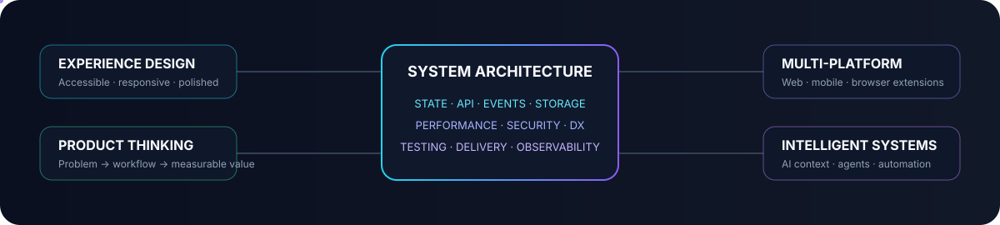

 

  

---

## 10-second profile

<table>
<tr>
<td width="25%" valign="top">

### 👋 Who

**Nirmal Sing Nithish**  
Frontend-focused product engineer building browser tools, mobile products, and AI-powered user experiences.

</td>
<td width="25%" valign="top">

### ⚙️ Strength

Turning messy workflows into crisp interfaces backed by solid state architecture, clean APIs, and production-minded delivery.

</td>
<td width="25%" valign="top">

### 🚀 Best signal

A growing Chrome MV3 product suite and a portfolio of full-stack, AI, and app-building work across public and private repos.

</td>
<td width="25%" valign="top">

### 🎯 Direction

Advanced frontend systems, browser-native developer tools, practical AI workflows, and scalable product execution.

</td>
</tr>
</table>

---

## Featured browser suite

<table>
<tr>
<td width="33%" valign="top">

### ⚡ [Tabix](https://github.com/nithish-dev-03/Tabix)

**Tab command center for power users.**

Built for fast tab discovery, grouping, cleanup, session control, and memory-aware browser workflows.

**Ships with**

- Fuzzy search and keyboard actions
- Domain grouping and native tab groups
- Bulk actions, bookmarks, sessions
- Vanilla JS + Chrome Manifest V3

</td>
<td width="33%" valign="top">

### 🧩 [Devoza](https://github.com/nithish-dev-03/Devoza)

**Live website inspector for developers.**

Built to understand existing websites faster: inspect UI, extract design systems, audit quality, and export actionable frontend context.

**Ships with**

- Design token and component extraction
- Accessibility and asset inspection
- React, CSS, Tailwind, JSON exports
- React + TypeScript + MUI + MV3

</td>
<td width="33%" valign="top">

### ✦ [Flowza](https://github.com/nithish-dev-03/Flowza)

**AI operating layer inside the browser.**

A side-panel assistant for page understanding, document analysis, persistent local memory, workflow execution, and automation.

**Ships with**

- AI page and document analysis
- Local memory and multi-step workflows
- MCP, WebSockets, Puppeteer bridge
- React 19 + TypeScript + Zustand

</td>
</tr>
</table>

`TABIX / ORGANIZE` → `DEVOZA / UNDERSTAND` → `FLOWZA / AUTOMATE`

---

## Current GitHub portfolio

<table>
<tr>
<td width="50%" valign="top">

### 💡 Browser + tooling

- [Tabix](https://github.com/nithish-dev-03/Tabix) — lightweight tab manager and workspace organizer
- [Devoza](https://github.com/nithish-dev-03/Devoza) — website inspector and design-system extraction tool
- [Flowza](https://github.com/nithish-dev-03/Flowza) — AI side-panel for browser tasks, context, and automation

</td>
<td width="50%" valign="top">

### 🤖 AI + full-stack product work

- [Nivora AI](https://github.com/nithish-dev-03/Nivora-ai) — conversational AI app with streaming chat and retrieval workflows
- [orvethiq](https://github.com/nithish-dev-03/orvethiq) — modular chat app with FastAPI + PostgreSQL backend
- [pdf-rag](https://github.com/nithish-dev-03/pdf-rag) — document understanding and retrieval-focused experiments
- [help-desk](https://github.com/nithish-dev-03/help-desk) — support ticket platform built with FastAPI and SQLAlchemy

</td>
</tr>
<tr>
<td width="50%" valign="top">

### 📱 Mobile + app products

- [InsightWallet](https://github.com/nithish-dev-03/InsightWallet) — personal finance app with budgets, goals, and AI insights
- [Aether Weather](https://github.com/nithish-dev-03/aether-weather-app) — premium weather experience with offline support and AI-guided forecasting
- [Todo-list](https://github.com/nithish-dev-03/Todo-list) — productivity app with responsive UI and clean task state
- [Django_todo-app](https://github.com/nithish-dev-03/Django_todo-app) — full-stack todo app with Django backend and React frontend

</td>
<td width="50%" valign="top">

### 🧪 Portfolio + learning + experiments

- [portfolio-software-dev](https://github.com/nithish-dev-03/portfolio-software-dev) — secure, backend-powered developer portfolio
- [portfolio-software-dev-web-gl](https://github.com/nithish-dev-03/portfolio-software-dev-web-gl) — immersive WebGL-inspired portfolio experience
- [Redux-thunk-learn](https://github.com/nithish-dev-03/Redux-thunk-learn) — learning-focused Redux and async state project
- [python-interview-questions](https://github.com/nithish-dev-03/python-interview-questions) — interview prep and architecture deep dives
- [python_automation](https://github.com/nithish-dev-03/python_automation) — Python automation and workflow experiments

</td>
</tr>
</table>

---

## Architecture mindset

<table>
<tr>
<td width="25%" valign="top">

### 01 · Frame

Problem, user flow, constraints, success signals, and edge cases first.

</td>
<td width="25%" valign="top">

### 02 · Architect

State ownership, API contracts, events, storage, runtime boundaries, and delivery path.

</td>
<td width="25%" valign="top">

### 03 · Build

Thin vertical slices, reusable primitives, fast feedback, and intentional interaction details.

</td>
<td width="25%" valign="top">

### 04 · Harden

Accessibility, performance, loading states, testing, failure handling, and cleanup.

</td>
</tr>
</table>

> I prefer simple product experiences backed by architecture that can grow without becoming noisy.

---

## Technical map

<table>
<tr>
<td width="25%" valign="top">

### Experience

React 18/19  
TypeScript / JavaScript  
Material UI / Ant Design  
Tailwind / Shadcn  
Responsive UI / accessibility

</td>
<td width="25%" valign="top">

### Application

Redux Toolkit  
Thunk / Saga  
Zustand  
React Router  
Flutter / Dart

</td>
<td width="25%" valign="top">

### Platform

Node.js / Express  
MongoDB / Atlas  
REST APIs / JWT  
Chrome Manifest V3  
Service workers / content scripts

</td>
<td width="25%" valign="top">

### Intelligence

LLM APIs  
RAG / context design  
MCP workflows  
Browser automation  
Playwright / Puppeteer

</td>
</tr>
</table>

---

## Current build direction

<table>
<tr>
<td width="33%" valign="top">

### 🧪 Frontend systems

React 19 patterns, better state boundaries, performance, and architecture-level UI decisions.

</td>
<td width="33%" valign="top">

### 🤖 Practical AI

RAG, context engineering, agentic workflows, and AI products that solve specific user problems.

</td>
<td width="33%" valign="top">

### 🧭 Browser tooling

Chrome extension runtimes, side panels, service workers, MCP bridges, and automation layers.

</td>
</tr>
</table>

---

### Have a useful product idea or frontend problem?

I’m interested in building sharp interfaces, developer tools, AI-assisted workflows, and cross-platform products that actually ship.

  

Clean systems · Fast interfaces · Useful products

