 

  

---

## 👋 About Me

I'm **Nirmal Sing Nithish**, a software developer focused on building modern frontend applications, full-stack products, browser extensions, and practical AI-powered tools.

My development journey started with frontend engineering using React and JavaScript, later expanding into mobile development with Flutter and backend development using Node.js and Python.

I enjoy understanding how systems work, designing their architecture, and turning complex requirements into usable software.

### What I work on

- **Frontend Engineering:** Building scalable React applications with TypeScript, reusable components, and maintainable state management.
- **Browser Engineering:** Developing Chrome extensions using Manifest V3, service workers, content scripts, and browser APIs.
- **Backend Development:** Building REST APIs, authentication systems, database integrations, and backend services.
- **AI Engineering:** Exploring LLM integrations, RAG pipelines, embeddings, vector search, and agent-based workflows.
- **Mobile Development:** Building cross-platform applications using Flutter and Dart.

---

## 🛠️ Technology Stack

### Frontend

### Backend & Databases

### Mobile Development

### Browser Development & Automation

### AI & Developer Tools

 

---

## 🚀 Featured Projects

### 01. Flowza — AI-Powered Browser Assistant

An AI-powered browser assistant designed to understand web pages, retrieve relevant context, and execute browser workflows through structured tool interactions.

**Key Engineering Areas**

- Chrome Manifest V3 architecture.
- React 19 and TypeScript.
- AI agent execution loops.
- Tool calling and MCP integration.
- Browser automation using Puppeteer.
- WebSocket communication.
- Context retrieval and local memory.
- Tool validation and execution security.

**Tech Stack:** React, TypeScript, Node.js, Express, Puppeteer, MCP, WebSockets.

---

### 02. InsightWallet — Personal Finance Application

A cross-platform personal finance application for tracking transactions, managing budgets, monitoring financial goals, and processing bank statements.

**Key Engineering Areas**

- Flutter application architecture.
- Riverpod state management.
- REST API integration.
- JWT authentication.
- Bank statement PDF processing.
- Bank-specific transaction parsers.
- MongoDB persistence.
- Financial summaries and insights.

**Tech Stack:** Flutter, Dart, Riverpod, Node.js, Express, MongoDB.

---

### 03. Help Desk — Ticket Management Platform

A full-stack support ticket management application built to explore backend engineering, API architecture, authentication, and database management.

**Key Engineering Areas**

- FastAPI REST API development.
- SQLAlchemy ORM.
- PostgreSQL database integration.
- Alembic database migrations.
- JWT authentication and authorization.
- HTTP-only cookie-based sessions.
- Redis-backed rate limiting.
- React Query and form validation.

**Tech Stack:** Python, FastAPI, SQLAlchemy, PostgreSQL, Redis, React, TypeScript, Tailwind CSS.

---

### 04. PDF RAG — Retrieval-Augmented Generation

A Python-based document question-answering system that explores the fundamentals of Retrieval-Augmented Generation.

**Key Engineering Areas**

- PDF text extraction.
- Document chunking.
- Embedding generation.
- PostgreSQL and pgvector.
- Semantic similarity search.
- Cosine-distance-based retrieval.
- Context construction.
- LLM-powered answer generation.

**Tech Stack:** Python, PostgreSQL, pgvector, SQLAlchemy, Gemini API, Embeddings.

---

### 05. Python Automation

A collection of Python automation workflows focused on browser automation, information extraction, and integrating external services.

**Key Engineering Areas**

- Playwright browser automation.
- Structured data extraction.
- AI-assisted information processing.
- Checkpoint-based execution.
- Data validation.
- CRM integration.
- Excel exports.

**Tech Stack:** Python, Playwright, LLM APIs, REST APIs.

---

### 06. Django Todo — Full-Stack Task Management

A task management application combining a Django backend with a modern React frontend.

**Key Engineering Areas**

- Django backend development.
- React 19 frontend.
- REST API integration.
- Optimistic UI updates.
- Task filtering and prioritization.
- Drag-and-drop task organization.

**Tech Stack:** Python, Django, React, TypeScript, Ant Design.

---

## 🧩 Browser Engineering Projects

A collection of browser-native developer tools focused on productivity, website inspection, and automation.

> Some of these repositories are private. Their descriptions are included to demonstrate the broader scope of my engineering work; repository access depends on visibility permissions.

<table>
<tr>
<td width="50%" valign="top">

### ⚡ Tabix

**Browser Tab Manager**

A Chrome extension designed to improve tab organization and browser productivity.

- Fuzzy tab search.
- Keyboard navigation.
- Native tab groups.
- Bulk tab operations.
- Bookmark integration.
- Session management.
- Memory-aware workflows.

**Tech:** JavaScript, Chrome Manifest V3.

</td>
<td width="50%" valign="top">

### 🧩 Devoza

**Website Inspection Toolkit**

A developer tool for inspecting websites and extracting reusable frontend design information.

- DOM inspection.
- Design token extraction.
- Typography and color analysis.
- Accessibility checks.
- Asset inspection.
- Frontend code exports.
- Design-system analysis.

**Tech:** React, TypeScript, Chrome Manifest V3.

</td>
</tr>
</table>

---

## 🧠 Engineering Interests

<table>
<tr>
<td width="50%" valign="top">

### Frontend Architecture

- Scalable component systems.
- State management patterns.
- Performance optimization.
- API integration.
- Design systems.
- Browser APIs.

</td>
<td width="50%" valign="top">

### Backend Engineering

- REST API design.
- Authentication and authorization.
- Database modeling.
- SQL and ORM.
- Caching.
- Deployment and CI/CD.

</td>
</tr>
<tr>
<td width="50%" valign="top">

### Applied AI

- LLM integrations.
- Retrieval-Augmented Generation.
- Embedding models.
- Vector databases.
- Context engineering.
- AI agent workflows.

</td>
<td width="50%" valign="top">

### Developer Tooling

- Chrome extensions.
- Manifest V3.
- Service workers.
- MCP integrations.
- Browser automation.
- Developer productivity tools.

</td>
</tr>
</table>

---

## 📊 GitHub Statistics

 

---

## 📌 Currently Exploring

- Building reliable AI agent execution systems.
- Improving RAG retrieval quality and evaluation.
- Advanced React and TypeScript architecture.
- PostgreSQL and vector database engineering.
- Backend security and automated testing.
- Production-ready browser automation.

---

## 🤝 Let's Connect

I'm interested in collaborating on frontend applications, developer tools, browser extensions, full-stack products, and practical AI-powered software.

  

**Build useful things. Understand the systems behind them. Keep improving.**

